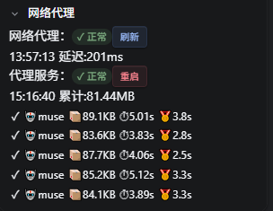

# openchamber-muse-proxy

muse 分流代理（`~/.local/bin/muse-proxy`）的 OpenChamber 扩展：状态栏小面板 + 后台 service。
按请求体 `model` 以 muse 开头走代理，其余直连，只监听 127.0.0.1。



## 状态栏小面板（五固定行，1s 自动刷）

- `网络代理：` + 状态徽标 + `[刷新]`（测速+换最快，约 10-20s）
- 更新时间 + Top 延迟，如 `16:33:09 延迟:194ms`；延迟每 60 秒自动重测当前节点
- `代理服务：` + 状态徽标 + `[重启]`
- 更新时间 + 累计流量，如 `13:47:06 累计:277.46MB`
- 最新 5 条请求，原生表格对齐：`✓ ｜ 🤖muse ｜ 📦99.8KB ｜ ⏱9.63s ｜ 🥇2826ms`（失败行末尾带 `⚠️原因`）

异常时在对应更新时间行追加原因（如 `· 原因：在途请求卡住`）；除两个按钮外其余只做展示，不可点击。

## 说明

- 切节点只影响新建连接，在途流不受影响；香港/台湾节点对 muse 不可用，测速自动排除
- 流量/日志记录只记内存，重启清零

## 迁移到新机器

脚本唯一真相在 `vendor/muse-proxy.py`，一键安装：

```bash
./scripts/install.sh [--proxy 宿主机:7897] [--ctl 宿主机:9097]
```

做四件事：拷脚本到 `~/.local/bin`（自动备份旧的）、写 `~/.config/muse-proxy/env`、
注册 systemd user 服务并启动、健康检查。有 systemd 才注册服务，
无 systemd 的机器装完扩展后在面板点「重启/拉起」即可。

`opencode.json` 默认不碰，装完按脚本最后打印的片段手动合
`provider.opencode-go.options.baseURL = http://127.0.0.1:8788/zen/go/v1`。

## 构建

```bash
bun run build
```

输出 `status/main.js`、`service/main.js` 必须提交（安装时不构建）。
